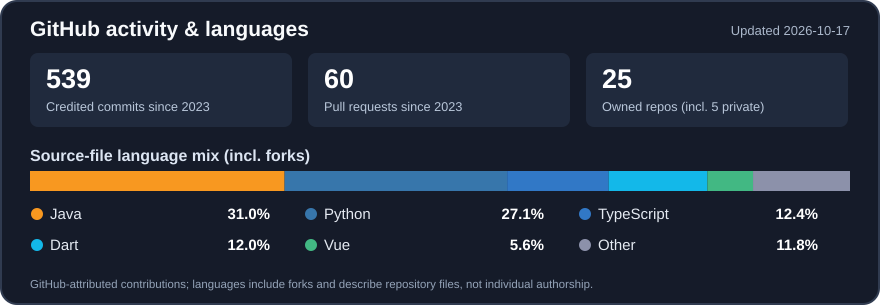

# Hey, I'm Pablo Gregório 👋

### Data & BI • Python Automation • Full-Stack Development

**I turn operational data into useful insights and repetitive work into reliable solutions.**

Based in São José dos Campos, Brazil 🇧🇷

---

## 👨‍💻 About me

I'm a **Database Technology student at FATEC São José dos Campos** and an **Administrative Analyst at FM2C**, working with **Gerdau's Maintenance Engineering team** in a data, BI and process automation capacity.

My journey started with industrial operations as an apprentice, evolved into a maintenance data internship and grew into my current analyst role. I like working at the intersection of **data engineering, analytics, automation and software development**: understanding an operational problem, building a solution and making information easier to act on.

- 📊 **Data & BI:** Power BI, Power Query, DAX, Excel, SQL, SAP HANA and KPI monitoring.
- 🐍 **Automation:** Python, VBA and SAP-related routines to reduce repetitive manual work.
- 💻 **Software:** Java/Spring Boot, REST APIs, React, Vue, TypeScript and relational databases.
- 🧪 **Quality:** automated tests, CI/CD, GitHub Actions and practical DevOps processes.
- 🎯 **Career direction:** Data / BI Analyst, Python automation, backend and full-stack engineering.

> I value solutions that work in the real world, not just in a demo.

## 🏭 Experience in practice

**FM2C · Assigned to Gerdau — Maintenance Engineering | Administrative Analyst (2026–present)**

- Maintain and improve Power BI reports and operational dashboards using **Power Query and DAX**.
- Analyze maintenance indicators, machine interruptions, costs and backlog to support operational decisions.
- Work with **SQL, SAP HANA, Excel and Python** for data analysis, reporting and automation.
- Collaborate with operational stakeholders to translate recurring needs into maintainable solutions.

**Earlier experience at Gerdau:** university internship in maintenance data/analytics (2025–2026) and industrial apprenticeship (2024–2025).

*Professional work is described at a high level; internal datasets, dashboards and company systems are not published here.*

## 🚀 Selected projects

### 🐾 [Grupo Suçuarana — Field Reporting App](https://github.com/pablohgs05/grupo-sucuarana-app) · In development
Volunteer, offline-first mobile reporting for field operations. The project combines **Flutter/Dart, SQLite, PDF generation and offline synchronization** with a **Java/Spring Boot REST API**, with attention to privacy, reliability and maintainability.

### ⚡ [HiATHOS — Energy Distribution Analytics](https://github.com/AthosFatecSjc/Athos) · 2026
Academic project developed with **TECSYS** to analyze public Brazilian electricity regulator (**ANEEL**) data, including **DEC/FEC** continuity indicators. My contributions included **Vue/Leaflet geospatial visualizations, forecasting-related interfaces, testing and DevOps/QA work**.

### 📈 [Neo Horizon — Jira Business Intelligence](https://github.com/pablohgs05/API_5S) · 2025
Academic BI platform for project management indicators, combining **Python ETL, React and Spring Boot** with Jira data. Worked on **quality assurance, testing processes and DevOps documentation**.

### 🧪 [Case Law — DevOps Coursework](https://github.com/pablohgs05/Case-Law) · 2026
Existing application used as the practical environment for my **DevOps coursework**. My focus is on **test strategy, unit/integration testing, quality checks and CI documentation**, not on developing the application's product features.

## 🎓 Academic project journey

| Semester | Project | What it explores |
|:--:|---|---|
| 1st | [API Porygon](https://github.com/pablohgs05/API-Porygon) | Python application for managing classes, teams and student performance |
| 2nd | [Weather Reader](https://github.com/VCCorpTeam/Leitor-de-clima) | Java, CSV processing and climate reports |
| 3rd | [Porygon2](https://github.com/PorygonAPI/Porygon2) | Java/Spring Boot, MySQL and scheduled news web scraping |
| 4th | [Porygon3](https://github.com/PorygonAPI/Porygon3) | Geospatial agricultural platform with Vue, Spring Boot and map workflows |
| 5th | [Neo Horizon](https://github.com/pablohgs05/API_5S) | Jira-connected BI, Python ETL and dashboards |
| 6th | [HiATHOS](https://github.com/AthosFatecSjc/Athos) | ANEEL analytics, geographic visualizations and DEC/FEC indicators |

📚 [Explore my detailed Database Technology academic portfolio →](https://github.com/pablohgs05/PortfolioBD-Pablo)

**Also contributed code in team repositories:** [HiATHOS frontend](https://github.com/AthosFatecSjc/frontend) · [HiATHOS backend](https://github.com/AthosFatecSjc/backend) · [PorygonAPI client](https://github.com/PorygonAPI/client) · [PorygonAPI server](https://github.com/PorygonAPI/server).

## 🛠️ Toolbox

**Languages, frameworks & tooling**

**Analytics & industrial systems**

## 📊 GitHub activity

How these numbers are updated

- **Automatic updates:** [GitHub Actions](.github/workflows/profile-stats.yml) refreshes this locally cached image every day, with no third-party stats service or manual README edits.
- **Contributions:** GitHub-credited commits and pull requests **since 2023**, including eligible activity in team repositories. The updater compares GitHub Actions and read-only token views **year by year** and keeps the larger count for each metric without double-counting overlap. GitHub's contribution eligibility and privacy rules still apply; these aren't counts of every commit on every branch.
- **Languages:** approximate share of **tracked source-file bytes** across accessible repositories I own, **including private repositories, archives and forks**. Code belonging to teammates or fork origins may be included; this does not measure personal authorship or proficiency. Dependencies, most generated files and binaries are excluded.
- **Privacy:** the read-only `PROFILE_STATS_TOKEN` allows analysis of accessible private repositories. Only aggregate counts and language percentages are published; private repository names, files and credentials are never exposed by the statistics generator.
- **Reliability:** the workflow checks the calculation with automated tests. If a token expires or data is incomplete, the job fails visibly and the last valid image remains published. GitHub PATs need renewal at expiration; they cannot safely renew themselves.

[View the updater](scripts/update-profile-stats.js)

---

## 🐍 Contributions

<picture>
  <source media="(prefers-color-scheme: dark)" srcset="https://raw.githubusercontent.com/pablohgs05/pablohgs05/output/github-contribution-grid-snake-dark.svg">
  
</picture>

Generated by a GitHub Actions workflow in this repository. Contribution graphs don't capture private professional work or every kind of technical contribution.

---

**Interested in data, automation or software engineering collaborations?**

[LinkedIn](https://www.linkedin.com/in/pablo-henrique05/) · [Email](mailto:pablogregorio8@gmail.com) · [GitHub](https://github.com/pablohgs05) · [Instagram](https://www.instagram.com/pablo.hgs/)

